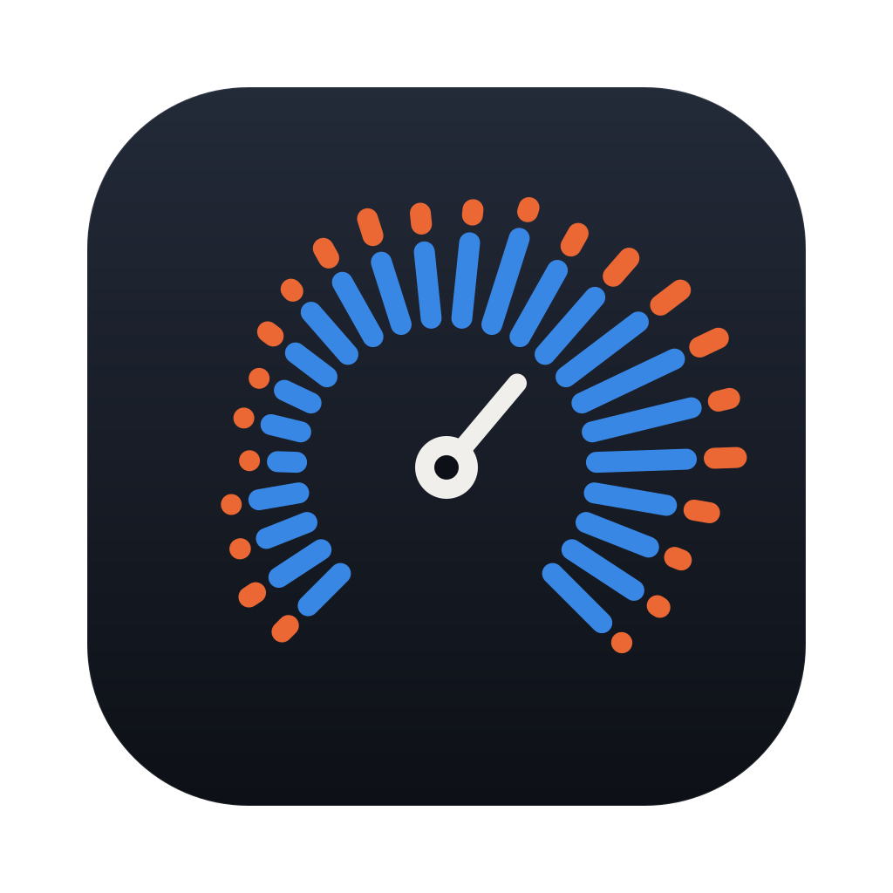
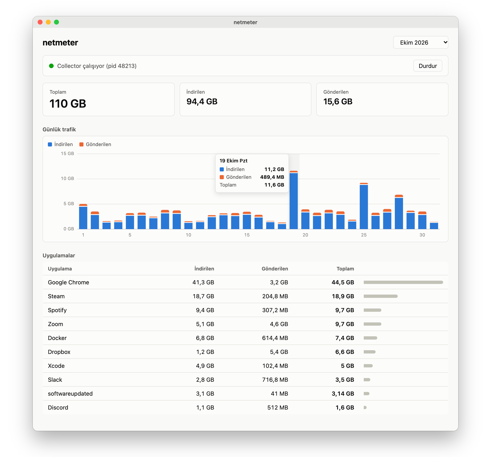
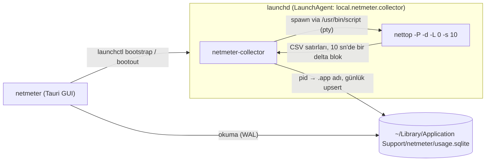
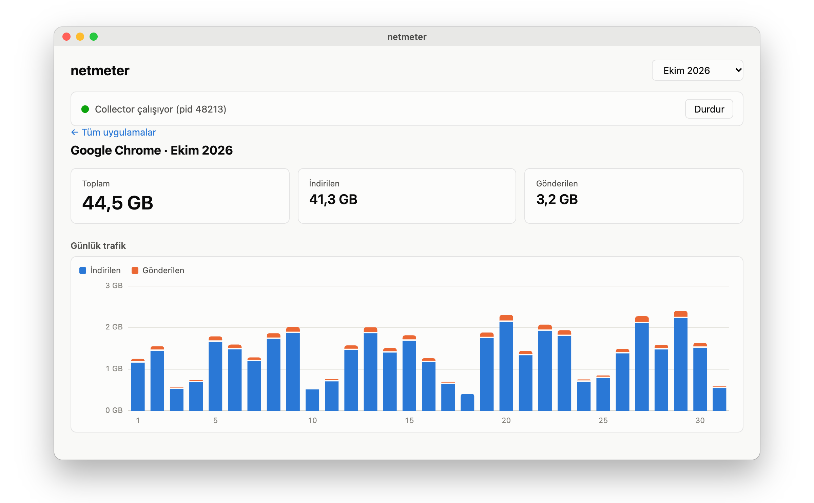

<p align="center">
  
</p>

# netmeter

[English](README.md) · **Türkçe**

macOS için uygulama bazında internet kullanım geçmişi. Arka planda çalışan bir collector, her uygulamanın günlük indirme/gönderme miktarını SQLite'a yazar; Tauri + React arayüzü aylık tabloyu, günlük grafiği ve uygulama detayını gösterir. GUI kapalıyken de veri toplanır.

<p align="center">
  <picture>
    <source media="(prefers-color-scheme: dark)" srcset="docs/screenshot-overview-dark.png">
    
  </picture>
  <br>
  <sub>Aylık görünüm (demo veri)</sub>
</p>

## Mimari



- **Veri kaynağı:** `nettop` delta modu. Root gerektirmez; ölçümde interface sayacının ~%94'ünü yakaladı (fark: paket header'ları). Kısa ömürlü process'ler de sayılır.
- **pty:** `nettop` pipe'a yazarken çıktıyı buffer'lıyor (dakikalarca gecikme). `script -q /dev/null` ile pseudo-terminal üzerinden çalıştırılınca her satır anında gelir. `script`'in stdin'i açık tutulmalı; EOF alırsa çıktıya `^D` basar.
- **Uygulama adı:** process'in executable path'indeki en dıştaki `.app` (Chrome helper'ları → "Google Chrome"); bundle dışındakiler dosya adıyla görünür. Ad çözülemeden kapanan process'ler nettop'un 15 karakterlik adıyla kaydedilir.
- **Tablo:** `daily_usage(day, app, bytes_in, bytes_out)`; gün yerel saate göre.

## Kullanım

```sh
pnpm install
pnpm tauri dev                     # geliştirme (collector için önce: cargo build --bins --manifest-path src-tauri/Cargo.toml)
pnpm tauri build --bundles app     # src-tauri/target/release/bundle/macos/netmeter.app
```

Uygulamada **Başlat** butonu collector'ı `~/Library/Application Support/netmeter/` altına kopyalar ve `~/Library/LaunchAgents/local.netmeter.collector.plist` ile yükler; login'de otomatik başlar, çökerse launchd yeniden başlatır. **Durdur** LaunchAgent'ı kaldırır, toplanan veri kalır. Collector hataları `~/Library/Application Support/netmeter/collector.log` dosyasına yazılır.

Tablodaki bir uygulamaya tıklayınca o uygulamanın aylık toplamları ve günlük grafiği açılır:

<p align="center">
  <picture>
    <source media="(prefers-color-scheme: dark)" srcset="docs/screenshot-app-dark.png">
    
  </picture>
  <br>
  <sub>Uygulama detayı (demo veri)</sub>
</p>

## Logo ve ikonlar

Logo [`scripts/generate-logo.ts`](scripts/generate-logo.ts) ile procedural üretilir: seed'li günlük trafik eğrisine göre uzunluğu belirlenen 24 saatlik download/upload bar'ı, bir gauge ibresinin etrafına dizilir. Tek komut `docs/logo.svg`'yi yeniden yazar ve `src-tauri/icons/` altındaki tüm ikonları ondan üretir:

```sh
pnpm logo   # TypeScript'i doğrudan çalıştırmak için Node.js 22.18+ gerekir
```

## Test

```sh
cargo test --manifest-path src-tauri/Cargo.toml
cargo clippy --all-targets --manifest-path src-tauri/Cargo.toml
pnpm build
```

## Lisans

[MIT](LICENSE) © 2026 Faruk CAN
