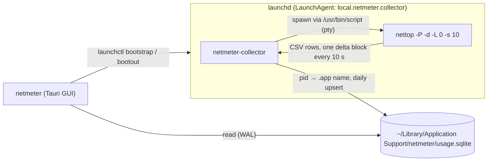

<h1 align="center">netmeter</h1>

<p align="center">
  <b>Per-app network usage history for macOS.</b><br>
  A background collector records how much each app downloads and uploads every day;<br>
  a small desktop app shows the monthly totals, the daily chart and per-app details.
</p>

<p align="center">
  <a href="LICENSE"></a>
  
  
  
  
</p>

<p align="center">
  
  
  
  
  
  
  
</p>

<p align="center">
  <a href="https://github.com/farukcan/netmeter/stargazers"></a>
  <a href="https://github.com/farukcan/netmeter/issues"></a>
  <a href="https://github.com/farukcan/netmeter/commits/main"></a>
  
  
  <a href="#contributing"></a>
</p>

<p align="center">
  <b>English</b> · <a href="BENIOKU.md">Türkçe</a>
</p>

---

## Table of Contents

- [Features](#features)
- [How It Works](#how-it-works)
- [Requirements](#requirements)
- [Installation](#installation)
- [Usage](#usage)
- [Data and Privacy](#data-and-privacy)
- [Uninstalling](#uninstalling)
- [Development](#development)
- [Project Structure](#project-structure)
- [Contributing](#contributing)
- [License](#license)

## Features

- **Per-app totals:** download and upload bytes for every app, grouped by day and month.
- **Helpers counted as their app:** Chrome, Electron and other helper processes are added to their parent `.app` (e.g. every Chrome helper → "Google Chrome").
- **Runs without the GUI:** the collector is a `launchd` LaunchAgent; it starts at login and is restarted by `launchd` if it crashes.
- **No root, no kernel extension:** data comes from macOS's built-in `nettop` in delta mode.
- **Short-lived processes included:** names are resolved as soon as a sample arrives, before the process can exit.
- **Monthly dashboard:** total / downloaded / uploaded tiles, a daily traffic chart and a sortable app table; click an app for its own daily chart. The view refreshes every 30 seconds.
- **One-click collector control:** **Başlat** (start) and **Durdur** (stop) buttons install and remove the LaunchAgent.

> [!NOTE]
> The user interface is currently in Turkish.

## How It Works



| Part | Details |
| --- | --- |
| **Data source** | `nettop` in delta mode, one sample block every 10 seconds. It needs no root and, in measurements, captured about 94% of the interface counters (the difference is packet headers). |
| **Pseudo-terminal** | `nettop` buffers its output for minutes when writing to a pipe. Running it through `script -q /dev/null` gives it a pty, so every line arrives immediately. `script`'s stdin must stay open; on EOF it prints `^D` into the output. |
| **App name** | The outermost `.app` bundle in the process's executable path. Executables outside a bundle use their file name. Processes that exit before their name is resolved are stored under `nettop`'s 15-character process name. |
| **Storage** | SQLite table `daily_usage(day, app, bytes_in, bytes_out)`, keyed by local date and app. WAL mode lets the GUI read while the collector writes. |

## Requirements

| Requirement | Version |
| --- | --- |
| macOS | Uses `nettop`, `launchd` and `proc_pidpath`; other platforms are not supported |
| [Rust](https://www.rust-lang.org/tools/install) | 1.85 or newer (2024 edition) |
| [Node.js](https://nodejs.org/) | 20.19+ or 22.12+ |
| [pnpm](https://pnpm.io/installation) | 10 or newer |
| Xcode Command Line Tools | `xcode-select --install` |

See the [Tauri prerequisites](https://v2.tauri.app/start/prerequisites/) for details.

## Installation

There are no prebuilt releases yet; build the app from source:

```sh
git clone https://github.com/farukcan/netmeter.git
cd netmeter
pnpm install
pnpm tauri build --bundles app
```

The app bundle is written to `src-tauri/target/release/bundle/macos/netmeter.app`. Move it to `/Applications` and open it.

## Usage

1. Open **netmeter**.
2. Click **Başlat** (start). The app copies the collector to `~/Library/Application Support/netmeter/` and loads it with `~/Library/LaunchAgents/local.netmeter.collector.plist`.
3. The first data appears in about 30 seconds. Pick a month from the selector and click an app to see its daily traffic.

The collector keeps running when the app is closed and starts again at every login. **Durdur** (stop) unloads and removes the LaunchAgent; collected data is kept.

## Data and Privacy

netmeter makes no network requests and sends no telemetry. Everything stays on your Mac:

| File | Purpose |
| --- | --- |
| `~/Library/Application Support/netmeter/usage.sqlite` | Daily usage database |
| `~/Library/Application Support/netmeter/netmeter-collector` | Installed collector binary |
| `~/Library/Application Support/netmeter/collector.log` | Collector errors (stderr) |
| `~/Library/LaunchAgents/local.netmeter.collector.plist` | LaunchAgent definition |

Only byte counts per app and day are stored; no hosts, addresses or packet contents.

## Uninstalling

Click **Durdur** (stop) in the app, or unload the LaunchAgent manually, then delete the data:

```sh
launchctl bootout gui/$(id -u)/local.netmeter.collector
rm ~/Library/LaunchAgents/local.netmeter.collector.plist
rm -rf ~/Library/Application\ Support/netmeter
```

Finally, delete `netmeter.app`.

## Development

```sh
pnpm install
cargo build --bins --manifest-path src-tauri/Cargo.toml   # builds the collector next to the GUI binary
pnpm tauri dev
```

The **Başlat** button looks for `netmeter-collector` next to the running GUI executable, so build the binaries before using it in dev mode.

### Tests and checks

```sh
cargo test --manifest-path src-tauri/Cargo.toml
cargo clippy --all-targets --manifest-path src-tauri/Cargo.toml
pnpm build   # type-checks with tsc, then builds the frontend
```

## Project Structure

```text
netmeter/
├── src/                          # React frontend
│   ├── App.tsx                   # Month selector, stat tiles, app detail view
│   ├── AppTable.tsx              # Per-app usage table
│   ├── DailyChart.tsx            # Daily traffic chart
│   ├── CollectorBar.tsx          # Collector status and start/stop buttons
│   ├── api.ts                    # Typed wrappers around Tauri commands
│   └── format.ts                 # Byte, month and day formatting
└── src-tauri/                    # Rust backend
    ├── src/
    │   ├── bin/netmeter-collector.rs   # Collector entry point
    │   ├── collector.rs          # Reads nettop, aggregates per app, writes to SQLite
    │   ├── nettop.rs             # nettop command and CSV line parser
    │   ├── app_name.rs           # pid → .app bundle name
    │   ├── db.rs                 # SQLite schema and queries
    │   ├── launch_agent.rs       # LaunchAgent install, uninstall and status
    │   ├── paths.rs              # Data, binary, log and plist locations
    │   ├── error.rs              # Error types
    │   └── lib.rs                # Tauri commands
    ├── Cargo.toml
    └── tauri.conf.json
```

## Contributing

Issues and pull requests are welcome.

1. Fork the repository and create a branch: `git checkout -b feat/my-change`
2. Make your change and run the [tests and checks](#tests-and-checks).
3. Commit with a [Conventional Commits](https://www.conventionalcommits.org/) message, e.g. `feat: add weekly view`.
4. Open a pull request.

## License

Distributed under the [MIT License](LICENSE). Copyright © 2026 Faruk CAN.
